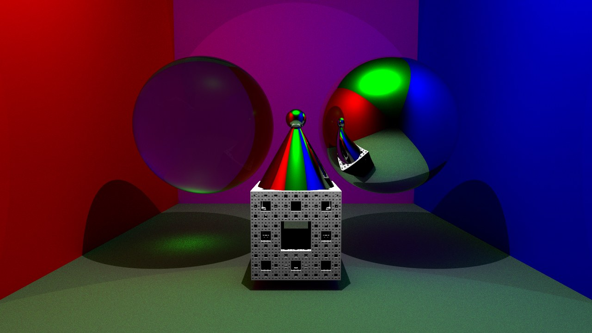

# Path tracer (Synthèse d'image réaliste)

Moteur de rendu par lancer de rayons en C++, réalisé pendant les TP de synthèse d'image réaliste du master Informatique ISICG (Université de Limoges, 2024).

Le projet part d'un squelette fourni par l'université (fenêtre, caméra, chargement des maillages, écriture des images). Le reste est mon travail.

*Scène finale (`_init14`), 1280×720, 256 échantillons par pixel, intégrateur de path tracing.*

## Ce qui est implémenté

- **Intégrateurs** : lancer de rayons simple, éclairage direct, Whitted (réflexions et réfractions), path tracing avec échantillonnage de l'hémisphère pondéré par le cosinus.
- **Lumières** : ponctuelles et surfaciques (ombres douces).
- **BRDF et matériaux** : Lambert, Phong, Blinn-Phong, Oren-Nayar, Cook-Torrance (microfacettes), miroir, transparent.
- **Géométrie** : sphères, plans, maillages triangulaires (Bunny, Conference) accélérés par une **BVH** construite récursivement.
- **Surfaces implicites** (SDF) : sphère, cône, fractale, et opérations **CSG** (union, intersection, différence).
- Rendu parallélisé avec **OpenMP**.

## Compilation

Projet Visual Studio (Windows) : ouvrir `RT_ISICG_etu.sln` et compiler en Release. Les bibliothèques (glm, assimp, stb) sont incluses dans `lib/`.

L'image rendue est écrite dans `results/image.jpg`. La scène, l'intégrateur et le nombre d'échantillons par pixel se choisissent dans `src/main.cpp` et `src/scene.cpp`.

## Technologies

C++, OpenMP, glm, assimp, stb.
